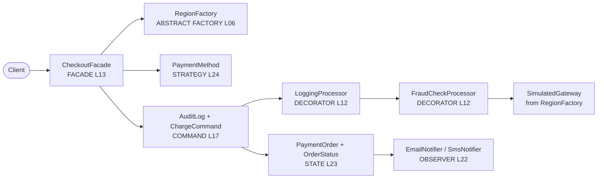

# Lesson 27 – Capstone: Mini Payment Platform

**ITGreenZone – GoF Design Patterns in Java** · [itgreenzone.com](https://itgreenzone.com)

This lesson pulls the course together:

1. **Choosing the right pattern**: a decision guide (see the slides and cheat sheet).
2. **Anti-patterns**: God Object, Golden Hammer, Singleton abuse, Lava Flow, Spaghetti Code, over-engineering.
3. **Capstone**: a Mini Payment Platform that combines seven patterns from the course.

## Architecture



## Class → pattern → lesson

| Class (package `capstone.…`) | Pattern | Role | Lesson |
|------------------------------|---------|------|--------|
| `checkout.CheckoutFacade` | Facade | Single entry point for clients | L13 |
| `region.RegionFactory`, `SingaporeRegion`, `SriLankaRegion` | Abstract Factory | Family of regional components: currency, tax, gateway | L06 |
| `region.RegionFactory.forCode(...)` | Factory Method (static) | Picks the concrete factory | L05 |
| `payment.PaymentMethod`, `CardPayment`, `PayPalPayment`, `PayNowPayment` | Strategy | Interchangeable fee algorithms | L24 |
| `processor.PaymentProcessor`, `SimulatedGateway` | (Decorator component) | The gateway being wrapped | L12 |
| `processor.LoggingProcessor`, `FraudCheckProcessor` | Decorator | Logging and fraud check around the gateway | L12 |
| `order.OrderStatus`, `PaymentOrder` | State (enum variant) | NEW → PAID → SHIPPED → DELIVERED, CANCELLED | L23 |
| `order.OrderListener`, `notify.EmailNotifier`, `SmsNotifier` | Observer | Notifications on every state change | L22 |
| `audit.AuditableCommand`, `ChargeCommand`, `AuditLog` | Command | Audit trail; undo = refund | L17 |

## How to run

**IntelliJ IDEA:** right-click `CapstoneDemo` and choose **Run**. The end-to-end test is `CapstoneTest`.

```bash
mvn test
mvn compile exec:java -Dexec.mainClass=com.itgreenzone.patterns.capstone.CapstoneDemo
```

## Exercise (≈30 min)

1. Implement `exercise.WalletPayment` (an e-wallet, 1.5% fee).
2. Implement `exercise.PushNotifier` (a mobile push on every status change).
3. Write down which pattern made each change easy, and which classes you did **not** have to touch.

**Answers:** the wallet is a new **Strategy**: `CheckoutFacade` didn't change; you just pass the new method in. Push is a new **Observer**: `PaymentOrder` didn't change; you just subscribe it. Neither change touched the gateway, decorators, state machine or audit log.
