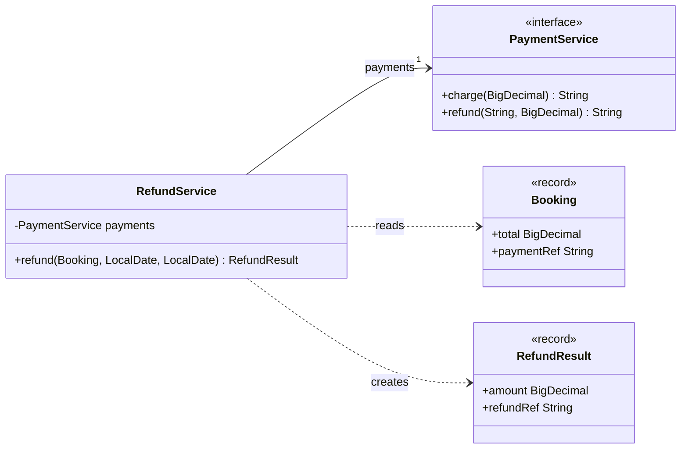
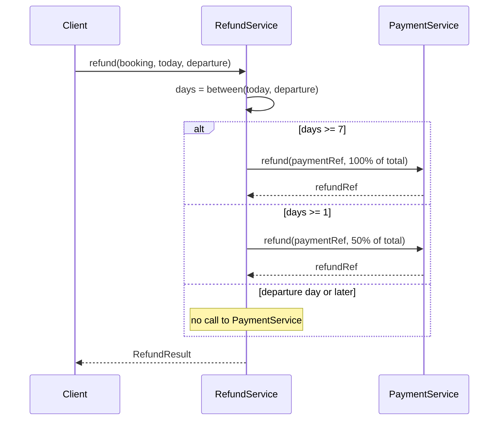

# Lesson 03 – Exercise solution: diagrams for `RefundService`

## Class diagram

## Sequence diagram

The test `solution.RefundServiceTest` proves the code behaves exactly as these diagrams describe.
